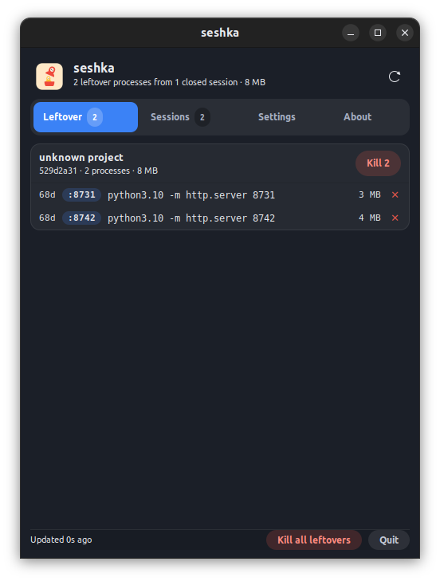
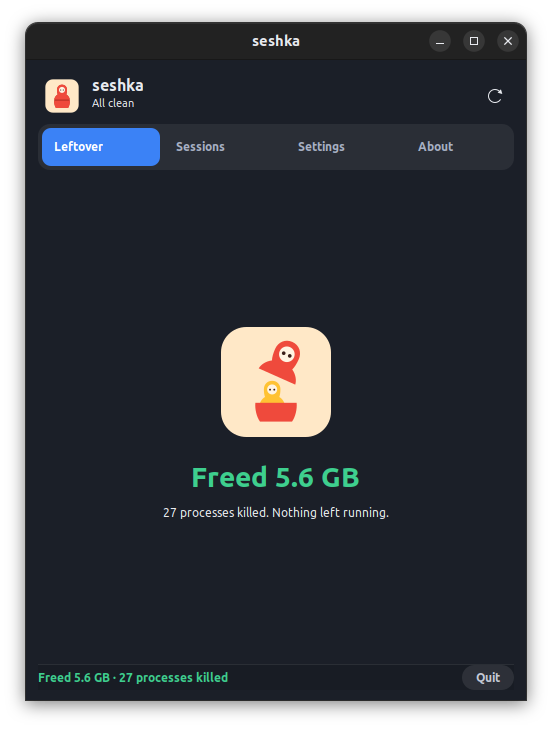

# seshka-linux

**Kill what Claude Code left behind.**

Claude Code sessions end. The dev servers, watchers, and browsers they started often don’t.
seshka-linux finds those processes on Ubuntu/Linux and lets you kill them — from a system tray app or the CLI.

Maintained by [PHP4U](https://github.com/php4umagento).  
Inspired by the macOS app [seshka](https://github.com/jigjoy-ai/seshka) by [JigJoy](https://jigjoy.ai).

<p align="center">
  
  
</p>

## Features

- Finds every process stamped by a Claude Code session (`CLAUDECODE=1`)
- Groups leftovers by session (ports, memory, age)
- Folds Chromium/Electron helpers into one row
- Shows open sessions (busy/idle) and can end them
- Optional auto-end for sessions idle longer than your limit (off by default; minimum 30 minutes)
- Protected command patterns (never killed by “kill all”)
- System tray icon: open nest while leftovers exist, closed when clean
- CLI for scripting and SSH

Nothing is uploaded. seshka only reads `/proc` and signals your own processes.

## Install

```bash
# system deps for the tray GUI (Ubuntu/Debian)
sudo apt install python3-gi gir1.2-gtk-3.0 gir1.2-ayatanaappindicator3-0.1

git clone git@github.com:php4umagento/seshka-linux.git
cd seshka-linux
pip install -e ".[dev]"
```


Optional: copy the desktop entry so you can launch from the app menu:

```bash
mkdir -p ~/.local/share/applications
cp packaging/seshka.desktop ~/.local/share/applications/
```

## Usage

### CLI

```bash
seshka list
seshka list --all
seshka list --json

seshka kill --all -n              # dry-run leftovers
seshka kill --all
seshka kill --pid 1234
seshka kill --session 529d2a31

seshka end-session 1026071 -n     # end an open Claude session
seshka gui                        # tray + window
```

Compatible shortcuts (like the macOS binary):

```bash
seshka --list
seshka --kill 1234
seshka --kill-session 1026071
```

### GUI

```bash
seshka-gui
# or
seshka gui
```

Tabs: **Leftover**, **Sessions**, **Settings**, **About**.  
Tray menu: open window, refresh, kill all leftovers, end idle sessions, quit.

Settings are stored in `~/.config/seshka/config.json`.

## How it works

Claude Code sets `CLAUDECODE=1` (plus session and parent PID) on everything it starts.
A process is a **leftover** once that Claude parent is gone. Processes that hide their
environment (some browsers) are still attributed if an ancestor was marked.
Session titles/projects are read from `~/.claude/projects` and `~/.claude/sessions`.

## Development

```bash
pip install -e ".[dev]"
pytest
```

See [CONTRIBUTING.md](CONTRIBUTING.md).

## License

MIT © PHP4U — see [LICENSE](LICENSE).

Third-party / upstream attribution (including reused matryoshka icons from JigJoy’s seshka):  
[NOTICE](NOTICE) and [THIRD_PARTY.md](THIRD_PARTY.md).

Upstream macOS app: [jigjoy-ai/seshka](https://github.com/jigjoy-ai/seshka) (MIT).
